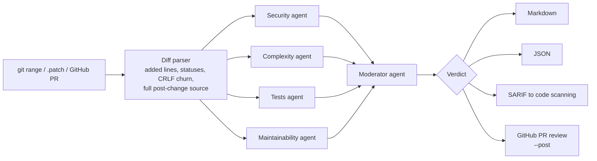

# Multi-Agent Code Review Board

A pull-request reviewer built as a **board of specialist agents**. Security, complexity, test-coverage and maintainability reviewers examine the same change **in parallel** (a LangGraph fan-out). A **moderator** agent then reconciles their findings: it merges duplicates, raises confidence when independent reviewers object to the same line, applies a per-file noise budget, ranks everything and issues a verdict.

It reviews a local git range, a patch file or a GitHub pull request, and reports as Markdown, JSON or **SARIF** for GitHub code scanning. It runs offline and free, with no LLM required.

## Problem

Human reviewers are inconsistent on the boring-but-critical checks: shell injection, a committed secret, a 25-branch function, a public function with no test, a `breakpoint()` left in. Single-purpose linters each produce their own noisy report, and nobody reconciles them into one "should this merge?" answer.

## How it works



Every agent is **diff-scoped**: it parses the full post-change file with Python's `ast` for context, but only reports on lines or functions the change touched. You don't get review comments about code nobody changed.

| Agent | Checks |
|---|---|
| **security** | `eval`/`exec`; `subprocess(..., shell=True)`; `os.system`/`popen`; `pickle`/`marshal` loads; `yaml.load` without SafeLoader; SQL built with f-strings, `%` or `.format` into `execute()`; `verify=False`; `tempfile.mktemp`; MD5/SHA-1; `random` used for tokens or passwords; `app.run(debug=True)`. Secrets in any language (AWS keys, private keys, GitHub and Slack tokens, high-entropy `api_key = "…"`, ignoring placeholders and env lookups). JS `eval`/`new Function`, `innerHTML =`/`dangerouslySetInnerHTML` |
| **complexity** | McCabe cyclomatic complexity (>10 medium, >20 high), nesting depth >4, length >60 lines, more than 6 parameters, for changed functions only |
| **tests** | Changed public functions must be referenced by changed tests. New untested functions are medium, modified ones low |
| **maintainability** | Bare `except:`, swallowed `except Exception: pass`, mutable default arguments, `breakpoint()`/`pdb`/`debugger;`, `print`/`console.log` in library code (not in scripts or `__main__` blocks), new TODO/FIXME, missing docstrings on new public functions, and **line-ending churn** (a whole file flipped between LF and CRLF, which hides the real change) |
| **moderator** | Merges the same rule reported by several agents; raises confidence for lines several agents object to; keeps the top *N* findings per file and reports how many were suppressed; verdict is *request changes* for any high or critical, *comment* for medium, *approve* otherwise |

A crashing agent can't sink the review: its failure is recorded in the reviewer notes and the others still report. New agents, including an LLM reviewer, are just functions `files -> (findings, note)` added to the board.

## Example: it caught a real mistake in this challenge

On an earlier day, an improvement to another repository accidentally committed files with CRLF line endings. Git then showed all 629 lines of the module as rewritten when the real fix was 47 lines. Reviewing that range with the board ([`examples/line-ending-churn-review.md`](examples/line-ending-churn-review.md)):

```
Verdict: 💬 Comment
🟠 medium  README.md             Line endings changed from LF to CRLF (309 lines removed, 292 added): the real change is hidden
🟠 medium  nextgen_quicksort.py  Line endings changed from LF to CRLF (629 lines removed, 651 added): the real change is hidden
🟠 medium  benchmark.py:18       2 changed public function(s) without tests: `inputs`, `main`
…
```

After running `git add --renormalize .`, the same range shrinks from +1156/−938 to the honest +301/−82, and the churn findings disappear. (Finding this needed a parser fix: `str.splitlines()` and `subprocess(text=True)` both silently strip `\r`, so the board reads git output as bytes.)

## Usage

```bash
pip install -e ".[dev]"

review-board --git main                       # review main...HEAD of the current repo
review-board --git main..feature --repo ../app
review-board --diff changes.patch             # or: git diff | review-board --diff -
review-board --all                            # audit the whole codebase at HEAD (first review of an existing repo)
review-board --git 4b825dc642cb6eb9a060e54bf8d69288fbee4904..HEAD   # empty tree: the entire history as one diff
review-board --pr octo/app#42                 # public PRs work without a token
review-board --pr octo/app#42 --post          # post as a PR review with inline comments (GITHUB_TOKEN)

review-board --git main --format sarif --out review.sarif
review-board --git main --fail-on high        # exit 1 if anything high or critical: a CI gate
```

| Option | Default | |
|---|---|---|
| `--format` | `markdown` | `markdown`, `json` or `sarif` |
| `--fail-on` | `never` | Exit with code 1 if any finding is at least this severity |
| `--min-severity` | `info` | Drop findings below this level |
| `--per-file-cap` | `10` | Noise budget per file |
| `--post` | off | Only with `--pr`; posts a review (`REQUEST_CHANGES` or `COMMENT`) with up to 30 inline comments |

### As a GitHub Action

This repository reviews itself on every push. See `.github/workflows/ci.yml`: the `self-review` job writes the Markdown review to the job summary and uploads SARIF to the Security tab.

## Tests

```bash
pytest -q
```

18 tests cover:
- diff parsing, including CRLF markers
- every rule of every agent, plus negative cases: SafeLoader `yaml.load`, parameterised SQL, placeholder secrets, untouched code, `print` in scripts
- the moderator's merging, noise budget and verdicts
- the parallel board with a deliberately crashing agent
- a real temporary git repo, including refusal of option-injection refs like `--output=`
- the GitHub PR fetch (mocked)
- the SARIF structure
- CLI exit codes

## Limitations

- The deep rules are Python-specific. Other languages get the line-level secret and JS checks.
- The tests agent uses name references, not coverage data.
- It's static analysis: it complements human review, it doesn't replace it.

## Future enhancements

- An optional LLM reviewer agent (local, via Ollama) with findings anchored to diff lines
- Tree-sitter parsers for JS/TS, Go and Java
- Coverage-aware test agent (read `coverage.xml`)
- Learning which rules a team dismisses, to tune the noise budget

## License

MIT
